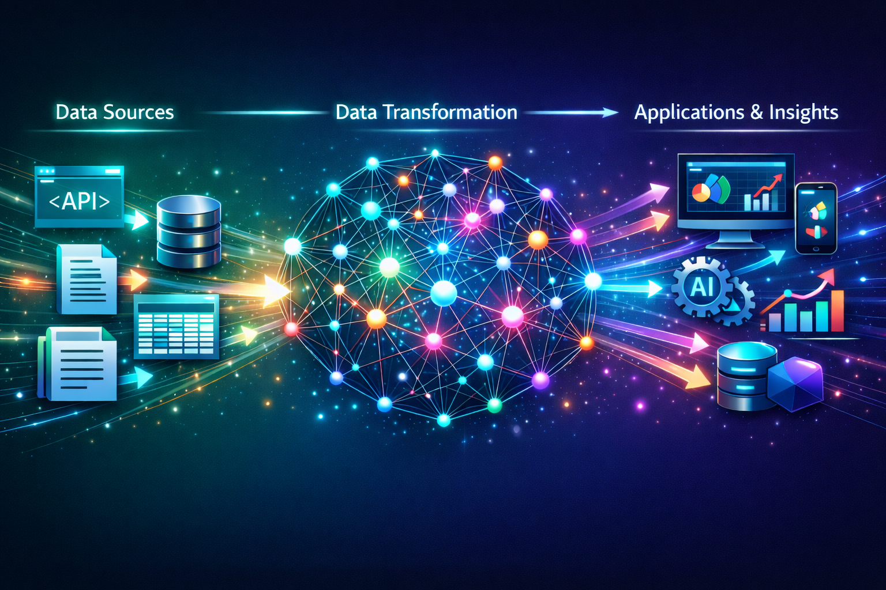
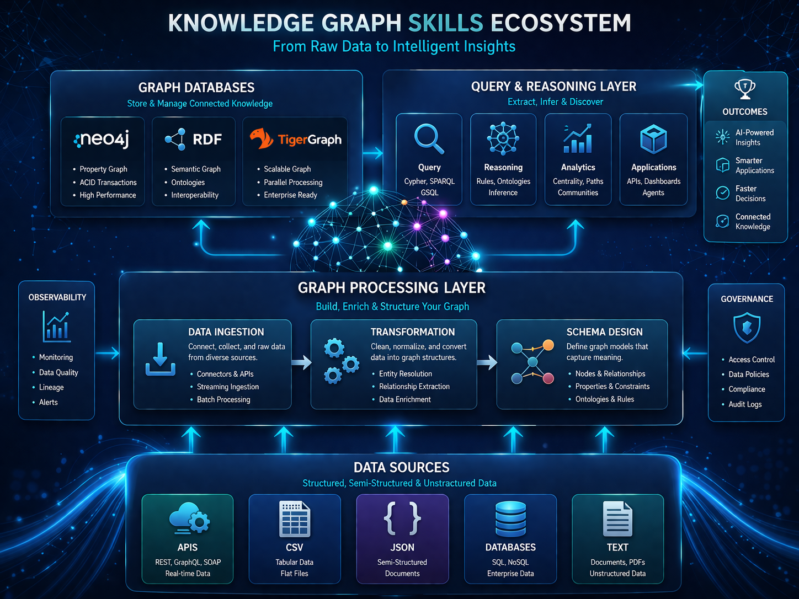

# 🧠 Knowledge Graph Skills Ecosystem

A comprehensive collection of **OpenClaw agent skills** designed to empower knowledge graph developers with cutting-edge tools for data ingestion, graph modeling, schema design, reasoning, querying, and integration.

---

## 🎯 Overview

This skills ecosystem provides **26 specialized modules** organized into **5 core categories**, enabling developers to:

- 📥 **Ingest** data from multiple sources
- 🗂️ **Model** and design graph schemas
- 🔗 **Integrate** with popular graph databases
- 🧠 **Reason** and perform inference
- 🔍 **Query** and retrieve knowledge efficiently



### 🛠️ Technology Stack

**Languages & Frameworks:**
-  - Core language for all skills
-  - Property graph database
-  - Semantic knowledge representation
-  - Graph query language
-  - Semantic query language
-  - API query language
-  - Data orchestration
-  - Natural language processing

**Key Libraries:**
- `neo4j` - Neo4j Python driver
- `rdflib` - RDF/OWL processing
- `pandas` - Data transformation
- `pydantic` - Data validation
- `networkx` - Graph algorithms
- `jsonschema` - Schema validation
- `sparql-client` - SPARQL queries
- `jinja2` - Template generation



---

## 📚 Skills Categories

### 1. 📥 Data Ingestion and Transformation

Transform raw data into graph-ready structures. These skills handle CSV files, JSON documents, APIs, and unstructured text.

| Skill | Description | Purpose |
|-------|-------------|---------|
| **CSV Graph Loader Generator** | Convert CSV datasets into graph-ready structures | Transform tabular data into nodes, edges, and triples |
| **JSON to Triples Converter** | Transform JSON documents into RDF triples | Enable semantic web integration |
| **API Ingestion Connectors** | Connect and fetch data from REST APIs | Real-time data synchronization |
| **ETL Pipeline Generator** | Build end-to-end ETL workflows | Orchestrate complex data pipelines |
| **Mapping DSL Builder** | Create domain-specific mapping languages | Define custom transformation rules |
| **Text Entity Relation Extractor** | Extract entities and relationships from text | Process unstructured knowledge |

**Use Case:** You have customer data in CSV, JSON APIs, and text documents. These skills automatically convert them into a unified graph format.

---

### 2. 🔗 Graph Integrations and Connectors

Connect your knowledge graph with leading graph database platforms and query languages.

| Skill | Description | Purpose | Tech Stack |
|-------|-------------|---------|-----------|
| **Neo4j Integration** | Full Neo4j driver and Cypher support | Property graph operations | Neo4j, Cypher, Python |
| **JanusGraph Connector** | JanusGraph database integration | Scalable distributed graphs | JanusGraph, Gremlin |
| **TigerGraph Connector** | TigerGraph platform integration | High-performance analytics | TigerGraph, GSQL |
| **RDF Triple Store Integration** | SPARQL and semantic web support | RDF/OWL knowledge bases | RDF, SPARQL, OWL |
| **GraphQL Graph Mapping** | GraphQL schema to graph mapping | API-first graph access | GraphQL |
| **REST API Wrapper Generator** | Auto-generate REST APIs for graphs | Expose graph data via HTTP | FastAPI, Flask |

**Use Case:** Seamlessly switch between Neo4j, RDF stores, or GraphQL endpoints while maintaining unified skill interfaces.

---

### 3. 🗂️ Graph Modeling and Schema Design

Design, validate, and evolve your graph schemas with confidence.

| Skill | Description | Purpose | Tech Stack |
|-------|-------------|---------|-----------|
| **Property Graph Schema Designer** | Interactive schema design for property graphs | Define nodes, edges, and properties | Neo4j, Property Graph |
| **RDF/OWL Schema Drafting** | Create semantic schemas with OWL | Build ontology-driven graphs | RDF, OWL, RDFS |
| **Graph Constraint Generator** | Auto-generate constraints and validations | Enforce data integrity | Pydantic, JSON Schema |
| **Graph Schema Validation** | Validate data against schemas | Ensure data quality | JSONSchema, RDF Shape |
| **KG Schema from Text** | Generate schemas from natural language | Rapid prototyping from requirements | NLP, Python |
| **Schema Migration Diff** | Compare and migrate between schemas | Version control for schemas | Python, Diff algorithms |

**Use Case:** Define your domain's schema once, validate all incoming data, and smoothly migrate to new schema versions without breaking changes.

---

### 4. 🧠 Graph Reasoning and Inference

Apply logical reasoning, rule engines, and inference algorithms to derive new knowledge.

| Skill | Description | Purpose | Tech Stack |
|-------|-------------|---------|-----------|
| **Graph Rule Engine Builder** | Create and execute inference rules | Derive implicit knowledge | Python, Rule Engines |
| **Ontology-Based Inference Helper** | OWL-based reasoning and entailment | Semantic reasoning | OWL, RDF, OWL-RL |
| **Causal Chain Analyzer** | Identify and analyze causal relationships | Root cause analysis | NetworkX, Graph Algorithms |
| **Graph Path Reasoning Analyzer** | Advanced path finding and reasoning | Multi-hop relationship discovery | Neo4j, Cypher, Pathfinding |
| **Transitive Closure Generator** | Compute transitive relationships | Explode implicit hierarchies | Graph Theory, Closure Algorithms |

**Use Case:** Define that "A manages B" and "B manages C", then automatically infer all transitive management relationships through the graph.

---

### 5. 🔍 Query and Retrieval Layer

Build sophisticated queries, optimize performance, and translate natural language to graph queries.

| Skill | Description | Purpose | Tech Stack |
|-------|-------------|---------|-----------|
| **NL to Graph Query Translator** | Convert natural language to Cypher/SPARQL | Democratize query access | NLP, LLMs, Cypher, SPARQL |
| **Graph Query Optimization Assistant** | Analyze and optimize query performance | Speed up slow queries | Query Analysis, Neo4j Profiling |
| **Graph Query Debugging Tool** | Step through and debug queries | Resolve query issues | Neo4j, Cypher, Debugging |
| **Multi-Hop Reasoning Query Builder** | Build complex traversal queries | Sophisticated relationship discovery | Cypher, Path Algorithms |
| **Graph Template Query Generator** | Generate reusable query templates | Standardize common patterns | Jinja2, Query Templates |

**Use Case:** Users ask "Who are all the stakeholders connected to this project?" and get instant results without writing Cypher.

---

## 🚀 Quick Start

### Installation

```bash
# Clone the repository
git clone <repository-url>
cd KnowledgeGraph

# Install all skills
pip install -r requirements.txt

# Or install individual skills
cd skills/data_ingestion_and_transformation/csv-graph-loader-generator
pip install -e .
```

### Basic Usage Example

```python
from skills.data_ingestion_and_transformation.csv_graph_loader_generator import CSVGraphLoader

# Load CSV and generate graph structure
loader = CSVGraphLoader('data/customers.csv')
graph_data = loader.generate_graph_structure()

# Export to Neo4j
loader.export_to_neo4j(graph_data, uri='bolt://localhost:7687')
```

---

## 🔄 Data Flow Architecture

The skills ecosystem follows a modular data flow:

```
Raw Data Sources
    ↓
[Data Ingestion & Transformation]
    ↓
Normalized Graph Format
    ↓
[Graph Integrations] → [Schema Modeling] → [Validation]
    ↓
Valid Graph Database
    ↓
[Reasoning & Inference]
    ↓
Enriched Knowledge Graph
    ↓
[Query & Retrieval]
    ↓
Insights & Results
```

---

## 📋 Complete Skills Directory

See detailed documentation at **[/skills/README.md](./skills/README.md)**

### Data Ingestion and Transformation (6 skills)
- `api-ingestion-connectors/` - REST API data fetching
- `csv-graph-loader-generator/` - CSV to graph conversion
- `etl-pipeline-generator/` - ETL orchestration
- `json_to_triples_converter/` - JSON to RDF triples
- `mapping-dsl-builder/` - Custom mapping definitions
- `text-entity-relation-extractor/` - NLP extraction

### Graph Integrations and Connectors (6 skills)
- `graphql-graph-mapping/` - GraphQL schema mapping
- `janusgraph-connector/` - JanusGraph integration
- `neo4j-integration/` - Neo4j driver & Cypher
- `rdf-trpple-store-integration/` - RDF/SPARQL support
- `rest-api-wrapper-generator/` - Auto REST API generation
- `tigergraph-connector/` - TigerGraph platform support

### Graph Modeling and Schema Design (6 skills)
- `graph-constraint-generator/` - Constraint generation
- `graph-schema-validation/` - Schema validation
- `kg-schema-from-text/` - NL schema generation
- `property-graph-schema-designer/` - Property graph design
- `rdf-owl-schema-drafting/` - OWL ontology design
- `schema-migration-diff/` - Schema versioning

### Graph Reasoning and Inference (5 skills)
- `causal-chain-analyzer/` - Causal analysis
- `graph-path-reasoning-analyzer/` - Path reasoning
- `graph-rule-engine-builder/` - Rule execution
- `ontology-based-inference-helper/` - OWL reasoning
- `transitive-closure-generator/` - Transitive closure

### Query and Retrieval Layer (5 skills)
- `graph-query-debugging-tool/` - Query debugging
- `graph-query-optimization-assistant/` - Performance tuning
- `graph-template-query-generator/` - Query templates
- `multi-hop-reasoning-query-builder/` - Complex queries
- `nl-to-graph-query-translator/` - NL to Cypher/SPARQL

---

## 💡 Use Case Examples

### Use Case 1: Knowledge Graph Construction from Multiple Sources

```
Customer CSVs → [CSV Loader] → Neo4j
Transactional APIs → [API Ingestion] → Neo4j
Unstructured Docs → [Text Extractor] → Neo4j
              ↓
        [Schema Validator]
              ↓
        Valid Knowledge Graph
```

### Use Case 2: Intelligent Query Interface

```
User: "Show me all projects managed by Sarah's team"
              ↓
   [NL to Query Translator]
              ↓
   Cypher: MATCH (p:Person {name:"Sarah"})-[:MANAGES*]->(team)...
              ↓
   [Query Optimizer]
              ↓
   Fast Results from Graph
```

### Use Case 3: Schema Evolution

```
Old Schema (v1.0)
         ↓
   [Schema Migration Diff]
         ↓
New Schema (v2.0)
         ↓
   Migration Plan + Validation
         ↓
Safely upgrade production graphs
```

---

## 🏗️ Architecture & Design Principles

### Modular Design
Each skill is:
- **Independent** - Can be used standalone
- **Composable** - Works seamlessly with other skills
- **Documented** - Comprehensive SKILL.md files
- **Tested** - Examples and reference implementations

### Technology Agnostic
- Support multiple graph databases (Neo4j, JanusGraph, TigerGraph, RDF stores)
- Work with various data formats (CSV, JSON, XML, RDF)
- Compatible with different query languages (Cypher, SPARQL, GraphQL)

### Developer-First
- Clear, intuitive APIs
- Extensive examples for each skill
- Built on popular Python libraries
- Active community support

---

## 📖 Documentation Structure

Each skill folder contains:

```
skill-name/
├── SKILL.md                 # Complete skill documentation
├── README.md               # Quick reference
├── REFACTORING_SUMMARY.md # Development notes
├── examples/               # Usage examples
├── references/             # Research & patterns
└── scripts/               # Utility scripts
```

**Start with each skill's `SKILL.md` for:**
- Detailed descriptions
- Input/output specifications
- Execution steps
- Best practices
- Integration points

---

## 🔗 Interconnections

Skills work together in pipelines:

```
CSV File
   ↓
[CSV Graph Loader] → Generate Nodes/Edges
   ↓
[Schema Validator] → Validate against schema
   ↓
[Constraint Generator] → Add constraints
   ↓
[Neo4j Integration] → Load to database
   ↓
[Query Optimizer] → Build efficient queries
   ↓
[NL Translator] → Enable natural language access
```

---

## 🎓 Learning Path

### Beginner
1. Start with **CSV Graph Loader Generator** - understand basic data transformation
2. Explore **Neo4j Integration** - see data in a graph database
3. Try **Graph Template Query Generator** - run pre-built queries

### Intermediate
4. Learn **Graph Schema Validation** - design and validate schemas
5. Experiment with **Graph Rule Engine Builder** - add reasoning
6. Build with **Multi-Hop Reasoning Query Builder** - complex queries

### Advanced
7. Master **NL to Graph Query Translator** - natural language interfaces
8. Deploy **ETL Pipeline Generator** - production workflows
9. Implement **Graph Query Optimization** - performance tuning

---

## 🤝 Contributing

To add a new skill:

1. Create a new folder in the appropriate category
2. Follow the skill template structure
3. Include SKILL.md, README.md, and examples
4. Test integration with existing skills
5. Submit PR with documentation

---

## 📝 License

MIT License - See LICENSE file

---

## 🔗 Resources

- [Skills Documentation](./skills/README.md)
- [OpenClaw Hub](https://clawhub.com)
- [Knowledge Graph Fundamentals](./START_HERE.md)
- [Image Resources Guide](./IMAGE_RESOURCES_IMPLEMENTATION_GUIDE.md)

---

## 📞 Support

For questions about specific skills:
1. Check the skill's `SKILL.md` documentation
2. Review examples in `examples/` folder
3. Check references in `references/` folder
4. Open an issue with detailed context

---

**Last Updated:** April 2026  
**Status:** Active Development  
**Total Skills:** 26  
**Categories:** 5  
**License:** MIT
